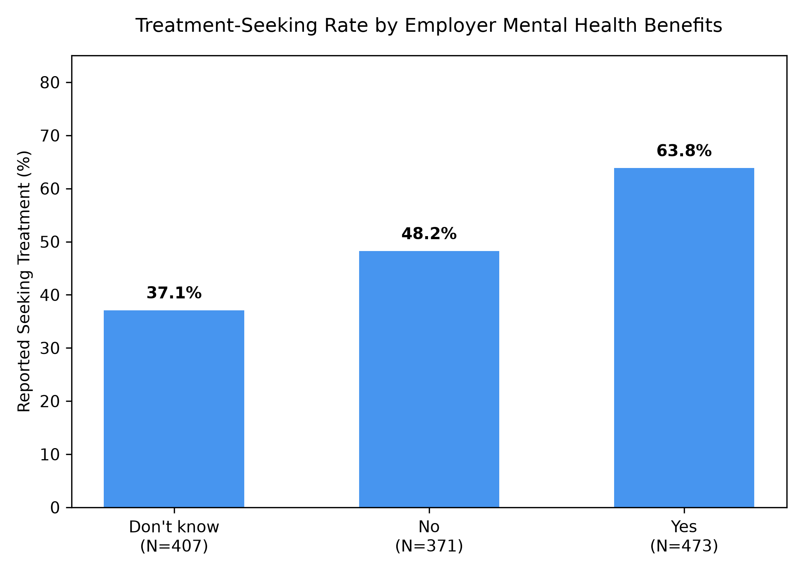
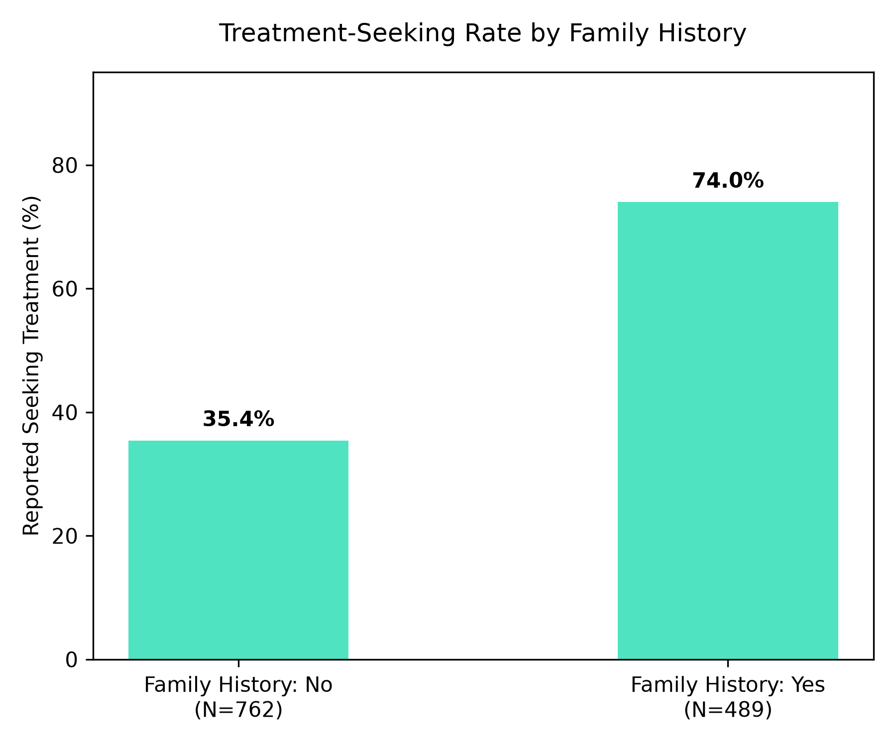

# Mental Health in Tech Survey: Treatment-Seeking Analysis

## Question
Do tech workers whose employers offer mental health benefits, or who have a
family history of mental illness, report seeking treatment more often?

## Data
OSMI Mental Health in Tech Survey (2014), 1,259 responses, 27 columns.
Source: [Kaggle](https://www.kaggle.com/datasets/osmi/mental-health-in-tech-survey),
licensed CC BY-SA 4.0. The data file isn't included in this repo; download it
and save it as `survey.csv` in this folder.

## Method
**SQL checks (SQLite):** age range, gender spellings, missing values, duplicates.
**Cleaning (pandas):**
- Removed rows with implausible ages (starting range: -1,726 to 99,999,999,999),
  keeping an 18 to 100 age range. Starting size: 1259 rows; Final size: 1,251 rows.
- Grouped various gender spellings into Male (982), Female (246), and
  Other / Not specified (23).
- Filled missing values for `self_employed` (18) and `work_interfere` (264) with "Not Specified".
- No duplicate rows found.
**Analysis:** Treatment-seeking rate by employer benefits and by family history.

## Findings

- Respondents whose employers offered benefits reported seeking treatment
  more often (63.8%, n=473) than those without (48.2%, n=371).
- Those with a family history of mental illness reported it far more often
  (74.0%, n=489) than those without (35.4%, n=762).

## Limitations
- Self-selected survey of tech workers from 2014, mostly in the US.
- Results show association, not necessarily causation.
- "Don't know" (benefits) had the lowest treatment rate (37.1%). The survey can't
  show which way the relationship runs: benefits may encourage people to seek
  treatment, or people already seeking treatment may be more likely to learn
  about their benefits.

## How to run
1. Install dependencies: `pip install pandas matplotlib`
2. Download the data and save it as `survey.csv`.
3. Run: `python3 analysis.py`